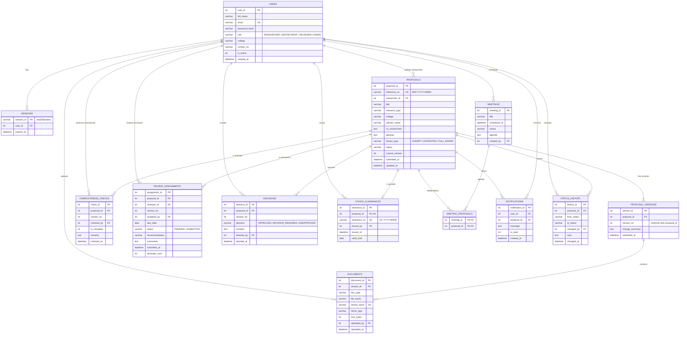
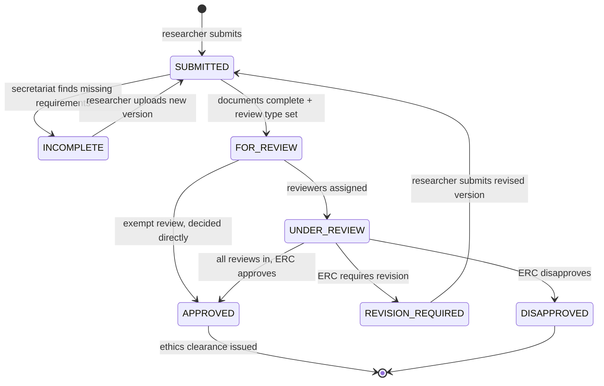

# RECMS — Entity Relationship Diagram

Derived from **Milestone 1: Preliminary Investigation Report / System Specification** (MSIT 1101 SoftEng).
Milestone 1 names these business objects: *Researcher, Research Proposal, Supporting Documents, ERC Secretariat,
Reviewer, Review Comments, Revised Proposal, Ethics Clearance.* Each one maps to the tables below. The schema
source of truth is [`lib/schema.ts`](../lib/schema.ts).

| Milestone 1 object        | Table(s)                                   |
| ------------------------- | ------------------------------------------ |
| Researcher, Secretariat, Reviewer | `users` (with `role`)              |
| Research Proposal         | `proposals`                                |
| Revised Proposal          | `proposal_versions` (one row per version)  |
| Supporting Documents      | `documents` (attached to a version)        |
| Review Comments           | `review_assignments` (recommendation + comments) |
| ERC decision              | `decisions`, `completeness_checks`         |
| Ethics Clearance          | `ethics_clearances`                        |
| Review meetings           | `meetings`, `meeting_proposals`            |
| Notifications / tracking  | `notifications`, `status_history`          |
| Login                     | `sessions`                                 |

## Relationships and cardinality

- One **researcher** submits many **proposals** (1:N).
- One **proposal** has one or more **versions** (1:N). Each revision or resubmission adds a version, so older versions stay on record and it's always clear which one is the latest.
- One **version** has many **documents** (1:N).
- **Proposals** and **reviewers** are many-to-many. `review_assignments` resolves this per version: `UNIQUE(proposal_id, reviewer_id, version_no)`.
- **Meetings** and **proposals** are many-to-many, resolved by `meeting_proposals` (composite PK).
- One **proposal** has at most one **ethics clearance** (1:0..1, `UNIQUE(proposal_id)`).

## Integrity constraints

- **Entity integrity:** every table has a non-null primary key. `meeting_proposals` uses a composite PK.
- **Referential integrity:** all foreign keys are enforced (`PRAGMA foreign_keys = ON`). Child rows cascade when a proposal is deleted.
- **Domain integrity:** `CHECK` constraints limit `role`, `status`, `research_type`, `review_type`, `doc_type`, `recommendation`, `decision` and the boolean flags to their allowed values. `email`, `reference_no`, `clearance_no` and `stored_name` are `UNIQUE`.

## Proposal status workflow

